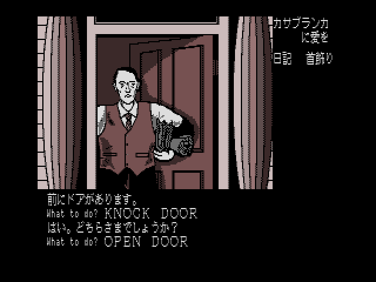

# Casablanca ni Ai wo — traducción al castellano (MSX2)

Traducción no oficial al castellano de **カサブランカに愛を ―殺人者は時空を越えて―**
(*Casablanca ni Ai wo*, «A Casablanca, con amor: el asesino que cruzó el tiempo»),
aventura conversacional de **Thinking Rabbit** para **MSX2** publicada en 1988 en dos discos.

1945: un científico aparece muerto y tú, detective, tendrás que viajar en su máquina del
tiempo hasta 1916 para aclarar el caso. Se juega escribiendo órdenes («LLAMA A LA PUERTA»,
«COGE LA NAVAJA»), y ahora en castellano.

 

## Qué hay aquí

Como es un juego japonés, **no se publican los discos**, ni originales ni traducidos:
solo dos **parches IPS**, uno por disco, y las fuentes para rehacerlos.

| Carpeta | Contenido |
|---|---|
| `releases/` | `Casablanca_ES_v1.0_disco1.ips` y `Casablanca_ES_v1.0_disco2.ips` |
| `tools/` | Scripts en Python que construyen los discos traducidos desde los originales |
| `src/` | `ext.asm`: ampliación del intérprete (Z80, pasmo) |
| `trad/` | Textos en castellano: mensajes, vocabulario y objetos |
| `font/` | Fuente de C-BIOS de la que sale la fuente de la traducción |
| `docs/` | Solución en PDF, lista de órdenes, notas técnicas y curiosidades |

## Discos necesarios

| Disco | Nombre habitual | SHA-1 |
|---|---|---|
| 1 | `Casablanca (1988)(Thinking Rabbit)(ja)(Disk 1 of 2).dsk` | `073e5fa25bbf9bf89e6f3f59bde7d86b826b2d97` |
| 2 | `Casablanca (1988)(Thinking Rabbit)(ja)(Disk 2 of 2).dsk` | `f99fb8c72065ae9128067b10d394599f0e729a50` |

Con los IPS aplicados:

| Disco traducido | SHA-1 |
|---|---|
| 1 | `bdca80827d47d4cec60e6990642f8c9abb6edf41` |
| 2 | `46872a364896e1ec93ed56c57a02bbd999498cb4` |

## Cómo aplicar el parche

Con cualquier programa de IPS (Lunar IPS, Floating IPS…), aplica cada parche a su disco:
`Casablanca_ES_v1.0_disco1.ips` al disco 1 y `Casablanca_ES_v1.0_disco2.ips` al disco 2.
Comprueba antes las sumas SHA-1 de la tabla.

También con Python 3, sin instalar nada:

```
python3 tools/ips.py aplica "Casablanca (...)(Disk 1 of 2).dsk" releases/Casablanca_ES_v1.0_disco1.ips disco1_es.dsk
python3 tools/ips.py aplica "Casablanca (...)(Disk 2 of 2).dsk" releases/Casablanca_ES_v1.0_disco2.ips disco2_es.dsk
```

## Cómo jugar

- Hace falta un MSX2 con disquetera (probado en openMSX con el Sony HB-F900).
- Arranca con el disco 1. Cuando lo pida, mete el disco 2 y pulsa ESPACIO.
- Escribe las órdenes y pulsa RETURN. Basta verbo + nombre: MIRA, COGE NAVAJA, LLAMA A LA
  PUERTA. Los artículos y preposiciones se ignoran.
- Se puede escribir en minúsculas, sin activar las mayúsculas.
- Sin tildes al teclear (PERIODICO). La Ñ es opcional: ENSEÑA y ENSENA valen igual. En un
  MSX japonés, que no tiene tecla Ñ, se escribe con la tecla «;»; en uno español o europeo,
  con su tecla Ñ.
- I = inventario. N, S, E, O y también ADELANTE, ATRAS, IZQUIERDA, DERECHA (o 8, 2, 4, 6),
  SUBE, BAJA, FUERA.
- GRABAR o GUARDAR graba la partida; CARGAR la recupera. Siguen valiendo las órdenes
  inglesas del original (SAVE GAME, LOAD GAME, LOOK, TAKE...).
- Cuando el texto llena la ventana aparece ▼ abajo a la derecha: pulsa una tecla.
- Si te atascas: [docs/Casablanca_ES_solucion.pdf](docs/Casablanca_ES_solucion.pdf).

### Verbos (forma principal; hay muchos sinónimos e infinitivos)

ABRE, LLAMA, HAZ, ENSEÑA, PRESENTATE, DA, DI, SUBE, BAJA, VE, MIRA, BUSCA, LEE, SIGUE, COGE,
ATISBA, ENTRA, CIERRA, PREGUNTA, DEJA, PON, AJUSTA, GIRA, ENCIENDE, USA, DESCERRAJA, BEBE,
ARREGLA, EMPUJA, ROMPE, HOJEA, NADA, MUEVE, COME, COMPRA, ARRANCA, SIENTATE, ECHA, AYUDA, MATA,
ACABA, DUERME, DESCANSA, BESA, PRENDE, LLEVA.

### Limitaciones conocidas

- Con varias palabras el orden da igual, pero el número cuenta: «SILLA DE RUEDAS» no vale,
  escribe RUEDAS.

## Qué se ha hecho

- Los 803 mensajes del juego traducidos del japonés.
- Fuente propia de 8×11 con á é í ó ú ü ñ Ñ ¿ ¡ « » (basada en la de C-BIOS), en los códigos
  de un byte que el juego reservaba al kana.
- Ajuste de línea por palabras y pausa ▼ en los textos largos.
- Analizador en castellano: unos 700 sinónimos sobre las mismas palabras del original,
  palabras de relleno que se ignoran y listas de objetos con artículo («Llevas un diario,
  un collar.»).
- Entrada en minúsculas (el original las convertía en kana) y Ñ.
- Panel derecho y textos del intérprete en castellano.

Detalles en [docs/NOTAS_TECNICAS.md](docs/NOTAS_TECNICAS.md) y
[docs/CURIOSIDADES.md](docs/CURIOSIDADES.md).

## Construir los discos desde las fuentes

Hace falta Python 3 y [pasmo](https://pasmo.speccy.org/) (comprobado con pasmo 0.5.3).

```
python3 tools/build.py disco1_original.dsk disco2_original.dsk salida
python3 tools/ips.py crea disco1_original.dsk salida/Casablanca_ES_disco1.dsk disco1.ips
python3 tools/ips.py crea disco2_original.dsk salida/Casablanca_ES_disco2.dsk disco2.ips
```

`build.py` comprueba el SHA-1 de los discos originales, sustituye dentro del disco 1
`RUNADV.COM` (intérprete parcheado + `src/ext.asm`) y `KANJI.FNT` (fuente nueva), y dentro del
disco 2 `CASAB.TBL`, `CASAB.MSG` y `CASAB.INT` (vocabulario, mensajes y guion). El resultado
coincide byte a byte con los discos de la tabla y con los IPS de `releases/`.

Otras herramientas: `tools/reglas2.py disco2.dsk` vuelca las reglas del juego en texto
legible; `tools/intparse.py disco2.dsk` comprueba el guion; `tools/pdf_solucion.py` genera la
solución en PDF (necesita reportlab y las fuentes DejaVu).

## Créditos

- *Casablanca ni Ai wo* © 1988 Thinking Rabbit.
- Traducción, dirección y pruebas: **araubi**.
- Desarrollado con Claude (Anthropic).
- Fuente basada en la de [C-BIOS](http://cbios.sourceforge.net/).

## Licencia y avisos

- Herramientas y código propio (`tools/`, `src/`): **MIT** ([LICENSE](LICENSE)).
- Textos de la traducción (`trad/`), documentación (`docs/`, este README) y parches IPS:
  **CC BY-NC-SA 4.0** ([LICENSE-CC](LICENSE-CC)).
- `font/cbios_font.bin`: licencia BSD de 2 cláusulas de C-BIOS
  ([font/LICENSE-CBIOS.txt](font/LICENSE-CBIOS.txt)).
- El juego original no está incluido ni cubierto por estas licencias: todos sus derechos son
  de sus titulares. Esta traducción es un homenaje sin ánimo de lucro; los parches solo
  sirven sobre discos que ya tengas. Se retirará si los titulares de los derechos lo piden.
